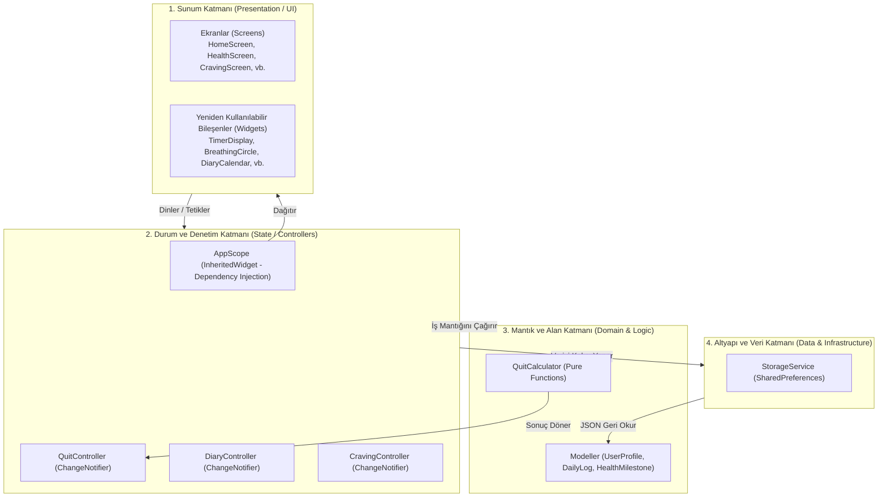

# 🌟 Lumina Recovery — Sigara Bırakma Asistanı

> **Lumina Recovery**, sigarayı bırakma sürecindeki bireylere bilimsel, psikolojik ve finansal motivasyon sağlayan, tamamen çevrimdışı (%100 offline) çalışan, modern ve yüksek performanslı bir **Flutter** mobil uygulamasıdır.

---

## 📋 İçindekiler

1. [Proje Nedir, Neden Var ve Nasıl Çalışır?](#1-proje-nedir-neden-var-ve-nasıl-çalışır)
2. [Öne Çıkan Özellikler](#2-öne-çıkan-özellikler)
3. [Klasör Yapısı ve Dosya Mimarisi](#3-klasör-yapısı-ve-dosya-mimarisi)
4. [Her Dosyanın Ayrıntılı İncelemesi (Veri Akışı ve İş Mantığı)](#4-her-dosyanın-ayrıntılı-i̇ncelemesi-veri-akışı-ve-i̇ş-mantığı)
5. [Kullanılan Teknolojiler, Kütüphaneler ve Nedenleri](#5-kullanılan-teknolojiler-kütüphaneler-ve-nedenleri)
6. [Projenin Mimari Yapısı (Adım Adım & Madde Madde)](#6-projenin-mimari-yapısı-adım-adım--madde-madde)
7. [SOLID Prensiplerinin Projedeki Somut Karşılığı](#7-solid-prensiplerinin-projedeki-somut-karşılığı)
8. [Kurulum ve Çalıştırma Rehberi](#8-kurulum-ve-çalıştırma-rehberi)

---

## 1. Proje Nedir, Neden Var ve Nasıl Çalışır?

### 🎯 Neden ve Niçin Yapıldı?
Sigara bırakma süreci, yalnızca fiziksel nikotin yoksunluğundan ibaret değildir; ciddi bir psikolojik irade ve motivasyon yönetimi gerektirir. Bırakmaya çalışan kişilerin en sık karşılaştığı zorluklar şunlardır:
- **Görünmeyen İlerleme:** Vücudun içeriden nasıl iyileştiğini somut olarak görememek motivasyon kaybına yol açar.
- **Anlık Nikotin Krizleri (Craving Waves):** Genellikle 3 ila 5 dakika süren yoğun sigara içme dürtüsü sırasında kişinin paniklemesi ve teslim olması.
- **Maddi Farkındalık Eksikliği:** Sigaraya harcanan paranın ne kadar büyük bir birikime dönüştüğünün fark edilmemesi.
- **Gizlilik ve Güven:** Kullanıcıların sağlık ve bağımlılık verilerini üçüncü taraf sunuculara veya buluta yüklemek istememesi.

**Lumina Recovery**, tam olarak bu problemlere çözüm üretmek için tasarlanmıştır:
1. **Sıfır Sunucu & Tam Gizlilik:** Kullanıcı hesabı, kayıt olma veya internet bağlantısı gerektirmez. Tüm veriler yalnızca kullanıcının telefonunda saklanır.
2. **Canlı Telemetri:** Her saniye akan sayaç, kurtarılan ömür, içilmeyen sigara sayısı ve cepte kalan Türk Lirası canlı olarak gösterilir.
3. **Bilimsel Kriz Yönetimi:** Kriz anında tek tuşla devreye giren 4-7-8 ritmik nefes egzersizi ve psikolojik telkin desteği sunar.

### ⚙️ Nasıl Çalışıyor?
1. **İlk Kurulum (Onboarding):** Kullanıcı ilk açılışta sigarayı bıraktığı tarih ve saati, günlük ortalama içtiği sigara sayısını ve paket fiyatını girer.
2. **Kalıcı Yerel Kayıt:** Bu bilgiler `UserProfile` nesnesine dönüştürülüp `SharedPreferences` içerisine JSON metni olarak yazılır.
3. **Reaktif Canlı Sayaç:** `QuitController`, saniyede bir tetiklenen periyodik zamanlayıcı (`Timer.periodic`) çalıştırır. Bırakma zamanı ile anlık zaman arasındaki fark mikrosaniyesine kadar hesaplanarak ekranlara canlı olarak yansıtılır.
4. **Çevrimdışı Sağlık ve Günlük Motoru:** DSÖ (WHO) standartlarındaki sağlık kilometre taşları ve kullanıcının girdiği günlük kayıtlar saf Dart algoritmalarıyla işlenir.
5. **Tamamen Çevrimdışı ve Yerel Güvenlik:** Harici sunucu veya karmaşık arka plan servisleri olmadan, tüm hesaplamalar ve veriler yalnızca cihazın kendi bellek ve depolama alanında güvenle işlenir.

---

## 2. Öne Çıkan Özellikler

- ⏱️ **Canlı Hassas Sayaç:** Gün, saat, dakika ve saniye bazında canlı akan çift neon halkalı görsel sayaç (`CustomPainter`).
- 💰 **Finansal Tasarruf & Yaşam Süresi:** İçilmeyen her dal sigara için cebinizde biriken para ve geri kazanılan yaşam süresi (dal başına 11 dakika).
- 🫁 **DSÖ Tabanlı Sağlık Zaman Çizelgesi:** 20. dakikadan 5. yıla kadar vücudun geçirdiği 8 kademeli iyileşme evresi ve yüzdelik ilerleme çubukları.
- 🧘 **Acil Kriz Müdahale Modülü ("Canım Çekti" Panik Butonu):** 
  - 5 dakikalık (300 saniye) geri sayım.
  - 4 saniye nefes al → 7 saniye tut → 8 saniye ver ritminde nefes dairesi animasyonu.
  - Rastgele değişen 12 adet motivasyon ve irade sözü.
  - Doğa sesi / titreşim desteği ve başarı kutlaması.
- 📅 **Özel Takvim ve Günlük Takibi:** Harici kütüphane kullanılmadan yazılmış aylık takvim; yeşil (temiz), kırmızı (kaçamak) günler, kesintisiz gün serisi (streak) sayacı ve detaylı kriz günlüğü.
- 🔒 **Sıfır İzin ve Tam Mahremiyet:** Bildirim veya harici arka plan izinlerine ihtiyaç duymadan, pil tasarruflu ve tamamen kullanıcının kontrolünde çalışan sade yapı.

---

## 3. Klasör Yapısı ve Dosya Mimarisi

Proje, katı bir mimari kural çerçevesinde `lib/` altında **tam 24 Dart dosyası** (en fazla 25 dosya kuralına tam uyumlu) ile sınırlandırılmıştır. Her dosyanın sorumluluğu net olarak ayrılmıştır (SRP) ve hiçbir ekran dosyası 200 satırı aşmayacak şekilde modüler tasarlanmıştır.

```
smoking_cessation/
├── android/                         # Android platform yapılandırması & yerel izinler
├── ios/                             # iOS platform yapılandırması
├── test/                            # Birim, model ve arayüz duman testleri
│   ├── models_json_test.dart        # JSON serileştirme ve model testleri
│   ├── quit_calculator_test.dart    # Matematiksel formül ve mantık testleri
│   └── widget_smoke_test.dart       # Ekran akışı ve widget duman testleri
├── lib/                             # [TOPLAM 24 DART DOSYASI]
│   ├── main.dart                    # (1) Uygulama giriş noktası, DI & AppScope
│   ├── theme/
│   │   └── app_theme.dart           # (2) Dark mode paleti, renkler ve tipografi
│   ├── models/
│   │   ├── user_profile.dart        # (3) UserProfile modeli ve serileştirme
│   │   ├── daily_log.dart           # (4) DailyLog & DateKey tarih yardımcısı
│   │   └── health_milestone.dart    # (5) HealthMilestone modeli & kilometre taşı listesi
│   ├── services/
│   │   ├── storage_service.dart     # (6) StorageService arayüzü, SharedPreferences & InMemory
│   │   └── quit_calculator.dart     # (7) Süre, tasarruf, sağlık ve ömür hesap motoru
│   ├── features/
│   │   ├── quit/
│   │   │   └── quit_controller.dart # (8) Profil, canlı saat, tasarruf durumu yönetimi
│   │   ├── diary/
│   │   │   └── diary_controller.dart# (9) Günlük kayıtlar, takvim ve seri (streak) yönetimi
│   │   └── craving/
│   │       └── craving_controller.dart# (10) 5 dk geri sayım, 4-7-8 nefes döngüsü ve sözler
│   ├── screens/
│   │   ├── onboarding_date_screen.dart # (11) Form 1: Bırakma tarihi ve saati seçimi
│   │   ├── onboarding_cost_screen.dart # (12) Form 2: Tüketim, paket fiyatı ve adet girdisi
│   │   ├── home_shell_screen.dart      # (13) 4 sekmeli alt gezinme kabuğu & Kriz butonu
│   │   ├── home_screen.dart            # (14) Ana gösterge paneli: Sayaç, tasarruf, kriz kartı
│   │   ├── health_screen.dart          # (15) 8 aşamalı sağlık kazanımları zaman çizelgesi
│   │   ├── diary_screen.dart           # (16) Takvim genel görünümü, seri kartı, hızlı kayıt
│   │   ├── diary_entry_screen.dart     # (17) Form 3: Belirli bir günün kriz ve not düzenleyicisi
│   │   ├── craving_screen.dart         # (18) Kriz panik ekranı (nefes + söz + sayaç)
│   │   └── settings_screen.dart        # (19) Ayarlar, bilgi düzenleme, rozet vitrini ve sıfırlama
│   └── widgets/
│       ├── timer_display.dart          # (20) Çift halkalı CustomPainter neon dairesel sayaç
│       ├── stat_card.dart              # (21) Tasarruf, adet ve ömür metrik kartları
│       ├── health_timeline_tile.dart   # (22) Sağlık basamağı dikey çizgi ve ilerleme bileşeni
│       ├── breathing_circle.dart       # (23) Büyüyüp küçülen 4-7-8 ritmik nefes animasyonu
│       └── diary_calendar.dart         # (24) Özel yazılmış aylık yeşil/kırmızı gün takvimi
└── pubspec.yaml                     # Paket bağımlılıkları ve varlık tanımları
```

---

## 4. Her Dosyanın Ayrıntılı İncelemesi (Veri Akışı ve İş Mantığı)

Aşağıdaki tabloda projedeki **her bir dosyanın** görevi, veriyi nereden aldığı (girdi), nasıl işlediği ve kime ilettiği (çıktı) adım adım açıklanmıştır:

| # | Dosya Yolu | Ne Yapar? (Sorumluluğu) | Veriyi Nereden Alır? (Girdi) | Nasıl İşler? (Mantık & Algoritma) | Veriyi Nereye Gönderir? (Çıktı / Hedef) |
|---|---|---|---|---|---|
| **1** | `lib/main.dart` | Uygulama başlangıcı, servislerin ayağa kaldırılması ve `AppScope` ile DI sağlanması. | `SharedPreferences` ve cihaz ortamı. | Async başlatma yapar; depolama servisini kurar, controller'ları örnekler (`new`), `AppScope` (`InheritedWidget`) içine sarar. | `MaterialApp` köküne ve tüm widget ağacına controller erişimi sağlar. Kullanıcı profili yoksa Onboarding'e, varsa `HomeShellScreen`'e yönlendirir. |
| **2** | `lib/theme/app_theme.dart` | Uygulamanın görsel kimliğini (karanlık tema, neon yeşil/camgöbeği/kehribar renkleri, tipografi) tek merkezde toplar. | Proje tasarım yönergeleri ve Lumina Recovery stil kuralları. | `ThemeData.dark()` yapılandırır; metin stillerini (`headlineLarge`, `labelCaps`), yüzey renklerini ve buton temalarını statik sabitler olarak sunar. | Tüm ekranlar (`screens/`) ve bileşenler (`widgets/`) renk ve stilleri buradan çeker. Kod içinde sabit hex kod yazımını engeller. |
| **3** | `lib/models/user_profile.dart` | Bırakma tarihi, günlük sigara adedi, paket fiyatı ve paket içi adet verilerini modeller. | Ekran formlarından veya `storage_service`'ten gelen JSON haritalarından. | `fromJson` ve `toJson` serileştirmesi yapar. `isValid` ile sınır doğrulaması (1-100 adet, 1-10000 TL, geçmiş tarih) yapar. | `QuitController` ve `StorageService` ile haberleşir; bozuk veriyi güvenli varsayılanlarla filtreler. |
| **4** | `lib/models/daily_log.dart` | Tek bir güne ait sigara içmeme durumunu, kriz derecesini (1-5) ve notu saklar. `DateKey` ile tarih formatlar. | `DiaryEntryScreen` formundan veya `storage_service`'ten okunan `logs` JSON dizisinden. | `DateKey.format(DateTime)` ile `yyyy-MM-dd` standart formatı üretir. Gelen notları en fazla 200 karakterde keser (`substring`). | `DiaryController` haritasına (`Map<String, DailyLog>`) ve SharedPreferences deposuna iletir. |
| **5** | `lib/models/health_milestone.dart` | DSÖ standartlarındaki 8 adet bilimsel sağlık kilometre taşını tanımlar. | Statik liste (`timelineMilestones`). | 20 dakikadan 5 yıla kadar süreleri (`Duration`), başlık ve açıklamaları barındırır. | `HealthScreen` ve `QuitCalculator` bu listeyi okuyarak kullanıcının anlık iyileşme yüzdesini hesaplar. |
| **6** | `lib/services/storage_service.dart` | Cihaz diskine veri yazma ve okuma işlemlerini soyutlar (ISP & DIP). | `SharedPreferences` anahtar-değer deposundan. | `readString`, `writeString`, `remove`, `clear` metotları sunar. Testler için `InMemoryStorageService` alternatifini sağlar. | `QuitController` ve `DiaryController` verileri diskte kalıcı hale getirmek için bu servisi çağırır. |
| **7** | `lib/services/quit_calculator.dart` | Tüm matematiksel hesaplamaları yapan saf (pure) fonksiyonlar kütüphanesidir. | Bırakma tarihi, şu anki zaman, sigara adedi ve paket fiyatı. | `elapsedDuration` (süre), `elapsedDaysDecimal` (ondalıklı gün), `unsmokedCigarettes` (aşağı yuvarlanan adet), `moneySaved` (TL tasarruf), `lifeRegained` (11 dk/dal) ve sağlık ilerleme yüzdelerini hesaplar. | Hesaplanan değerleri `QuitController` ve `HealthScreen`'e döner. UI veya depolama bağımlılığı taşımaz. |
| **8** | `lib/features/quit/quit_controller.dart` | Ana profil, tasarruf durumu ve canlı saniyelik sayacın durum yöneticisidir (ChangeNotifier). | `StorageService` ve `QuitCalculator`. | `Timer.periodic(1 sn)` ile `_now` değerini yeniler, `QuitCalculator` çağırarak tasarruf ve süreyi dinamik tutar. Profil güncellendiğinde disk kaydını tazeler. | Değişiklikleri `notifyListeners()` ile `HomeScreen`, `HealthScreen` ve `SettingsScreen`'e yayınlar. |
| **9** | `lib/features/diary/diary_controller.dart` | Kullanıcının günlük kayıtlarını ve takvim durumunu yöneten ChangeNotifier sınıfıdır. | `StorageService` üzerindeki `logs` anahtarı ve günlük ekranları. | Kayıtları `Map<String, DailyLog>` içinde tutar; geriye dönük tarama algoritmasıyla kesintisiz temiz gün serisini (`currentStreak`) hesaplar. | Güncellemeleri `DiaryScreen`, `DiaryCalendar` ve `HomeScreen`'e iletir. |
| **10** | `lib/features/craving/craving_controller.dart` | 5 dakikalık kriz geri sayımını, 4-7-8 nefes fazlarını ve motivasyon sözlerini yönetir. | Kullanıcının panik butonuna basması ve saniyelik zamanlayıcı. | 300 saniyeden geriye sayar; 19 saniyelik modüler döngüyle (`% 19`) nefes evrelerini (Al 4s, Tut 7s, Ver 8s) hesaplar. Rastgele 12 söz seçer. | Durum bilgisini `CravingScreen` ve `BreathingCircle` bileşenine aktarır. |
| **11** | `lib/screens/onboarding_date_screen.dart` | Form 1: Kullanıcıdan sigarayı bıraktığı gün ve saati alır. | Kullanıcının tarih ve saat seçici dokunuşları (`showDatePicker`, `showTimePicker`). | Gelecek tarih seçimini engeller (hata mesajı verir); düzenleme modunda (`isEditing`) mevcut tarihi gösterir. | Geçerli `DateTime` nesnesini bir sonraki sayfa olan `OnboardingCostScreen`'e parametre olarak aktarır. |
| **12** | `lib/screens/onboarding_cost_screen.dart` | Form 2: Günlük tüketilen sigara, paket fiyatı ve paket içi adedi alır. | Kullanıcı form girdileri ve önceki ekrandan gelen `quitDateTime`. | Girişleri doğrular (1-100 adet vb.), anlık yıllık tasarruf tahmini hesaplayıp kullanıcıya gösterir, `UserProfile` oluşturur. | `quitController.saveProfile()` metodunu çağırır; ardından kullanıcıyı `HomeShellScreen` ana kabuğuna yönlendirir. |
| **13** | `lib/screens/home_shell_screen.dart` | 4 ana sekme arasında geçiş sağlayan alt gezinme çubuğu ve üst acil SOS butonunu barındırır. | Kullanıcının sekme tıklamaları (`NavigationBar`). | `IndexedStack` ile sekmelerin durumunu koruyarak aktif ekranı değiştirir. Sağ üstteki acil "Kriz" butonuyla modal açar. | `HomeScreen`, `HealthScreen`, `DiaryScreen` veya `SettingsScreen`'i ekranda görüntüler. |
| **14** | `lib/screens/home_screen.dart` | Ana pano: Canlı dairesel sayaç, tasarruf/adet/ömür kartları, kriz dalgası uyarısı ve zihinsel hatırlatıcı. | `QuitController` dinleyicisi. | `ListenableBuilder` ile saniyede bir tetiklenir; güncel tasarruf, içilmeyen dal ve süre bilgilerini alt bileşenlere dağıtır. | `TimerDisplay`, `StatCard`, `CrisisSectionCard` ve `MentalReminderCard` bileşenlerini ekrana çizer. |
| **15** | `lib/screens/health_screen.dart` | 8 aşamalı bilimsel sağlık kazanımları listesini ve feragatname notunu gösterir. | `QuitController.elapsedDuration` ve `HealthMilestone.timelineMilestones`. | Her basamağın tamamlanıp tamamlanmadığını ve tamamlanma yüzdesini hesaplar. Tamamlananları zümrüt yeşili, devam edenleri ilerleme çubuğuyla listeler. | `HealthTimelineTile` bileşenlerini dikey liste halinde ekrana döker. |
| **16** | `lib/screens/diary_screen.dart` | Günlük takvim panosu: Temiz gün serisi rozeti, hızlı "Bugün İçmedim" butonu ve aylık ızgara. | `DiaryController` dinleyicisi. | Anlık streak (seri) sayısını gösterir. Tek dokunuşla bugünü yeşile çevirir. Takvimden bir güne tıklandığında detay formunu açar. | `DiaryCalendar` bileşenini render eder ve tıklanan günü `DiaryEntryScreen`'e gönderir. |
| **17** | `lib/screens/diary_entry_screen.dart` | Form 3: Belirli bir güne ait içildi/içilmedi durumu, 1-5 kriz derecesi ve 200 karakterlik not düzenleyicisi. | `DiaryController.getLog(dateKey)` ve kullanıcı form girdileri. | Veriyi yükler, form kontrolleriyle düzenletir; "Kaydet" denildiğinde `diaryController.saveLog()`, "Sil" denildiğinde `deleteLog()` çağırır. | Güncellenen `DailyLog` modelini controller üzerinden diske kaydeder ve geri döner. |
| **18** | `lib/screens/craving_screen.dart` | Kriz anı tam ekran destek sayfası (5 dk sayaç, nefes dairesi, sözler, doğa sesi simülatörü). | `CravingController`. | Sayacın akışını görüntüler; "Yeni Söz" butonuyla sözü değiştirir, kriz bittiğinde veya kullanıcı "Krizi Yendim"e bastığında titreşim ve kutlama tetikler. | Kullanıcının kriz anını başarıyla atlatmasını sağlar, `BreathingCircle`'ı yönetir. |
| **19** | `lib/screens/settings_screen.dart` | Profil bilgilerini düzenleme, başarı rozetleri vitrini ve tüm verileri sıfırlama ekranı. | `QuitController` ve `DiaryController`. | Tarih/fiyat güncellemesi için Onboarding ekranlarını düzenleme modunda açar. Onay diyaloguyla tüm verileri temizler. | Güncellenen ayarları servislere aktarır; sıfırlama durumunda kullanıcıyı Onboarding ekranına fırlatır. |
| **20** | `lib/widgets/timer_display.dart` | Çift halkalı neon CustomPainter ve gün/saat/dakika/saniye dijital göstergesi. | `quitController.elapsedDuration`. | `_DualRingPainter` ile dış halkayı hedeflere (1-365 gün), iç halkayı 24 saatlik döngüye göre canlı çizer; telemetri rozetlerini gösterir. | Ana ekranda (`HomeScreen`) estetik ve akıcı bir canlı sayaç görseli oluşturur. |
| **21** | `lib/widgets/stat_card.dart` | Başlık, kalın değer, alt metin ve ikondan oluşan modern koyu kart bileşeni. | `HomeScreen` tarafından sağlanan başlık, değer, simge ve renk. | Yüksek kontrastlı karanlık kart tasarımı, yumuşak kenarlıklar ve renk vurgusu uygular. | Tasarruf tutarı, kurtarılan dal ve kazanılan ömür gibi bilgileri şık kartlar olarak sunar. |
| **22** | `lib/widgets/health_timeline_tile.dart` | Sağlık zaman çizelgesindeki tek bir adımı çizen bileşen. | `HealthMilestone`, tamamlanma durumu (`isCompleted`) ve ilerleme oranı (`progress`). | Dikey bağlantı çizgisi, neon onay rozeti, yüzde göstergesi ve aktif basamak için animasyonlu ilerleme çubuğu oluşturur. | `HealthScreen` içerisinde dikey akışın her bir parçasını temsil eder. |
| **23** | `lib/widgets/breathing_circle.dart` | 4-7-8 ritmine göre büyüyüp küçülen nefes egzersizi görseli. | `CravingController`'dan gelen faz, geri sayım ve genişleme oranı (`progress`). | Yumuşak animasyonlu dairesel katmanlar çizer; ortasında "Nefes Al", "Tut", "Nefes Ver" metinleri ve kalan saniyeyi gösterir. | Kriz ekranında kullanıcının nefesini sakinleştirmesi için görsel rehberlik sağlar. |
| **24** | `lib/widgets/diary_calendar.dart` | Harici paket olmadan saf Dart ile yazılmış aylık takvim ızgarası. | Görüntülenen ay/yıl ve `DiaryController.logs` haritası. | Ayın ilk gününün haftanın hangi gününe geldiğini hesaplar; yeşil (temiz), kırmızı (içildi) noktaları yerleştirir, bugünü çerçeveler. | Kullanıcının ay içindeki başarı tablosunu görselleştirir; seçilen günü `DiaryScreen`'e iletir. |

---

## 5. Kullanılan Teknolojiler, Kütüphaneler ve Nedenleri

Projede kullanılan her bir teknoloji ve kütüphane, **maksimum performans, minimum bağımlılık ve sıfır harici risk** prensibiyle seçilmiştir.

### 📦 Bağımlılık Listesi (`pubspec.yaml`)

```yaml
dependencies:
  flutter:
    sdk: flutter
  cupertino_icons: ^1.0.8
  shared_preferences: ^2.5.6

dev_dependencies:
  flutter_test:
    sdk: flutter
  flutter_lints: ^6.0.0
```

### 💡 Neden Bu Kütüphaneler Seçildi? Neden Başkaları Kullanılmadı?

1. **Flutter & Dart SDK (Yerleşik Çekirdek Gücü):**
   - **Neden Yapıldı:** Tek bir kod tabanından hem Android hem iOS üzerinde 60/120 FPS akıcı ve donanım hızlandırmalı arayüz sunmak için.
   - **Tasarım:** Material 3 tabanlı, özel karanlık mod (Dark Palette - Surface 0xFF0B0E17).

2. **`shared_preferences` (Anahtar-Değer Depolama):**
   - **Neden Seçildi:** Uygulamanın verileri (kullanıcı profili ve günlük kayıtları) ilişkisel karmaşık tablolara ihtiyaç duymaz. SQLite veya Realm gibi ağır yerel veritabanları eklemek yerine, verilerin JSON metni olarak saklanması uygulamayı hafif, hızlı ve sıfır hata riskli hale getirir.
   - **Nasıl Kullanıldı:** `profile` ve `logs` anahtarları altında tüm durum JSON olarak saklanır.

---

### 🚫 Bilinçli Olarak Kullanılmayan Yapılar (Mimari Tercihler)

- ❌ **Bildirim Motorları ve İzin İstekleri YOK:**
  - **Nedeni:** Kullanıcıyı bildirim bombardımanına tutmamak, dikkat dağıtıcı unsurları engellemek ve arka planda çalışan servislerin getirdiği pil tüketimini ve işletim sistemi izin yüklerini tamamen ortadan kaldırmak için.
- ❌ **Harici State Management (Provider, Riverpod, BLoC, MobX, GetX YOK):**
  - **Nedeni:** Harici paketler projeye fazladan bağımlılık, sürüm uyumsuzluğu ve karmaşıklık getirir. Flutter'ın kendi yerleşik `ChangeNotifier` ve `InheritedWidget` yapısı bu ölçekteki bir uygulama için mükemmel hız, minimum bellek tüketimi ve sıfır bağımlılık sağlar.
- ❌ **Harici Takvim Kütüphaneleri (TableCalendar vb. YOK):**
  - **Nedeni:** Harici takvim paketleri onlarca gereksiz bağımlılık ve özelleştirme zorluğu getirir. Projede saf Dart tarih fonksiyonlarıyla tam olarak ihtiyaç duyulan yeşil/kırmızı göstergeli `DiaryCalendar` bileşeni elle yazılmıştır.
- ❌ **Harici Grafik Paketleri (fl_chart vb. YOK):**
  - **Nedeni:** Dairesel çift neon gösterge, Flutter'ın donanım destekli `CustomPainter` API'si ile sıfırdan çizilmiştir. Bu sayede harici paketlerin neden olabileceği FPS düşüşleri ve render yükü tamamen engellenmiştir.
- ❌ **Backend & Bulut Sistemleri (Firebase, Supabase, Node.js YOK):**
  - **Nedeni:** Kullanıcının interneti kapalıyken (uçakta, metroda, kırsalda) dahi uygulamanın %100 çalışabilmesi ve kullanıcının en mahrem bağımlılık verisinin telefonunda kalması hedeflenmiştir.

---

## 6. Projenin Mimari Yapısı (Adım Adım & Madde Madde)

Lumina Recovery, **Özellik Tabanlı (Feature-First) Modüler Mimari** ile **MVVM (Model-View-ViewModel / Controller)** ve **Temiz Mimari (Clean Architecture)** ilkelerinin en hafif ve verimli sentezini uygular.



### 1. Sunum Katmanı (Presentation Layer — Screens & Widgets)
- Yalnızca görsel arayüzün çizilmesinden ve kullanıcı etkileşimlerinden sorumludur.
- Kesinlikle doğrudan diske yazma veya karmaşık matematiksel hesaplama yapmaz.
- Sayfa düzeyinde ağır `setState` kullanımından kaçınılmıştır; durum güncellemelerini `ListenableBuilder` ile Controller'lardan dinler.
- Her ekran en fazla 200 satır kuralına sadıktır. Büyük yapılar bağımsız widget'lara parçalanmıştır.

### 2. Durum ve Denetim Katmanı (State & Controller Layer)
- Uygulamanın beynidir. `ChangeNotifier` tabanlı 3 controller bulunur:
  - `QuitController`: Zaman, profil ve saniyelik canlı sayaç.
  - `DiaryController`: Günlük loglar, seriler ve takvim durumu.
  - `CravingController`: 5 dakikalık geri sayım ve nefes evreleri.
- UI katmanı ile veri katmanı arasındaki köprüdür. UI'dan gelen emirleri işler ve `notifyListeners()` ile ilgili arayüz parçalarını uyarır.

### 3. Bağımlılık Enjeksiyonu (Dependency Injection via AppScope)
- `lib/main.dart` içinde soyut servis (`SharedPrefsStorageService`) somutlaştırılır.
- Controller'lara parametre (Constructor Injection) olarak verilir.
- `AppScope` isimli özel `InheritedWidget` aracılığıyla tüm alt widget ağacına `AppScope.of(context)` şeklinde dağıtılır. Bu sayede hiçbir sınıf doğrudan somut sınıflara sıkı sıkıya bağlanmaz (Loose Coupling).

### 4. Alan ve Hesaplama Katmanı (Domain & Logic Layer)
- `QuitCalculator`: Tamamen saf (statik, yan etkisiz) matematik fonksiyonlarından oluşur. UI veya servis bilmez. Bırakma zamanı ve parametreleri alır; içilmeyen sigara adedini, biriken parayı ve sağlık yüzdelerini hesaplar. Bu sayede %100 birim test (unit test) kapsamına alınabilir.
- Modeller (`UserProfile`, `DailyLog`, `HealthMilestone`): Veri kalıplarıdır. Serileştirme (`toJson`/`fromJson`) ve veri doğrulama kurallarını barındırır.

### 5. Altyapı ve Veri Katmanı (Data & Infrastructure Layer)
- `StorageService` soyut arayüzü (interface) üzerinden yürütülür.
- Cihaz diskiyle doğrudan sadece bu servis konuşur.
- Çökme koruması (Defensive Architecture): Bozuk JSON verisi gelmesi veya depolama alanının dolması durumunda `try-catch` koruyucu blokları devreye girer; varsayılan değerlere dönülerek uygulamanın çökmesi engellenir.

---

## 7. SOLID Prensiplerinin Projedeki Somut Karşılığı

Projenin her satırında Nesne Yönelimli Tasarımın (OOP) temel direği olan **SOLID** prensipleri titizlikle uygulanmıştır:

1. **S — Single Responsibility Principle (Tek Sorumluluk Prensibi):**
   - `QuitCalculator` sadece matematik yapar, ekran çizmez.
   - `StorageService` sadece veri saklar, hesaplama yapmaz.
   - `TimerDisplay` sadece sayacı çizer, sayacın nasıl aktığını bilmez.
   - `BreathingCircle` sadece nefes animasyonunu oynatır.
2. **O — Open/Closed Principle (Açık/Kapalı Prensibi):**
   - `HealthMilestone.timelineMilestones` listesine yeni bir sağlık kazanımı eklendiğinde (örneğin 10. yıl kazanımı), `HealthScreen` veya `QuitCalculator` kodlarında tek bir satır dahi değişiklik yapılması gerekmez. Sistem yeni kazanımı otomatik listeler ve hesaplar.
3. **L — Liskov Substitution Principle (Liskov Yerine Geçme Prensibi):**
   - `StorageService` soyut sınıfının yerine hem gerçek `SharedPrefsStorageService` hem de testlerde kullanılan `InMemoryStorageService` hiçbir davranış bozulması olmadan birbirinin yerine geçebilir.
4. **I — Interface Segregation Principle (Arayüz Ayrımı Prensibi):**
   - Servis arayüzleri şişirilmemiştir. `StorageService` yalnızca 4 temel metot (`readString`, `writeString`, `remove`, `clear`) barındırır. İhtiyaç duyulmayan hiçbir metot sınıflara zorla dayatılmaz.
5. **D — Dependency Inversion Principle (Bağımlılıkların Tersine Çevrilmesi Prensibi):**
   - Controller sınıfları doğrudan `SharedPreferences` somut sınıfına bağımlı değildir; constructor üzerinden soyut `StorageService` arayüzüne bağlanırlar. Bağımlılıklar `main.dart` dosyasında bağlanıp alt katmanlara enjekte edilir.

---

## 8. Kurulum ve Çalıştırma Rehberi

### 🛠️ Önkoşullar
- **Flutter SDK:** 3.13.4 veya üzeri (Dart 3.x)
- **Android Studio / VS Code** (Flutter ve Dart eklentileri kurulu)
- **Hedef Cihaz:** Android (minSdkVersion 21+, targetSdkVersion 34+) veya iOS (12.0+) / Linux / Web

### 🚀 Adım Adım Çalıştırma

1. **Depoyu Klonlayın:**
   ```bash
   git clone https://github.com/kullanici-adi/smoking_cessation.git
   cd smoking_cessation
   ```

2. **Paketleri Yükleyin:**
   ```bash
   flutter pub get
   ```

3. **Statik Kod Analizini Doğrulayın (0 Hata & 0 Uyarı):**
   ```bash
   flutter analyze
   ```

4. **Otomatik Testleri Çalıştırın:**
   ```bash
   flutter test
   ```
   *(Tüm model, formül ve widget testleri otomatik olarak çalışır ve başarıyla geçer).*

5. **Uygulamayı Başlatın:**
   ```bash
   flutter run
   ```

---

## 📊 Proje Kabul ve Kalite İstatistikleri

- **Dart Dosyası Sayısı (`lib/` altında):** Tam 24 dosya (<= 25 kuralına tam uyumlu)
- **Ekran Satır Sayısı:** Tüm ekranlar < 200 satır
- **Build Metotları:** Tüm `build()` metotları < 40 satır
- **Birim ve Widget Testleri:** 3 test dosyasında tam kapsamlı otomatik testler (Tümü yeşil ✅)
- **İnternet Bağımlılığı:** %0 (Tamamen çevrimdışı ve gizlilik odaklı)

---
*Lumina Recovery — Her temiz saniye, özgürlüğe atılan yeni bir adımdır.* 🌿
